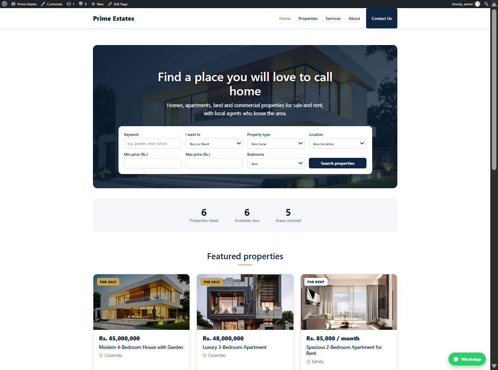
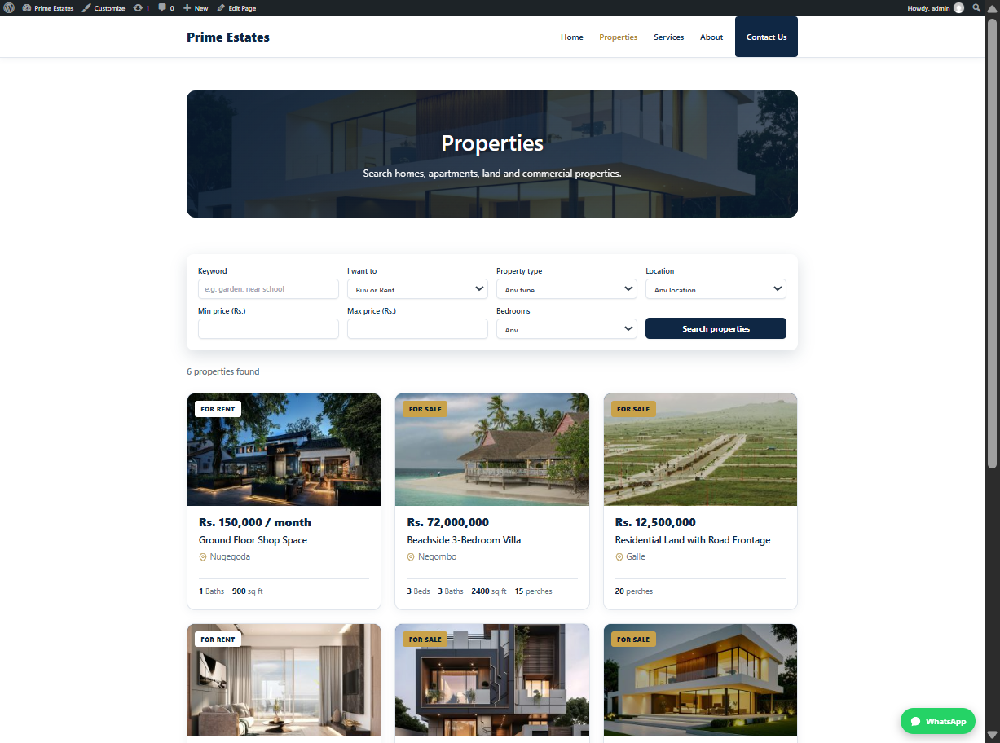
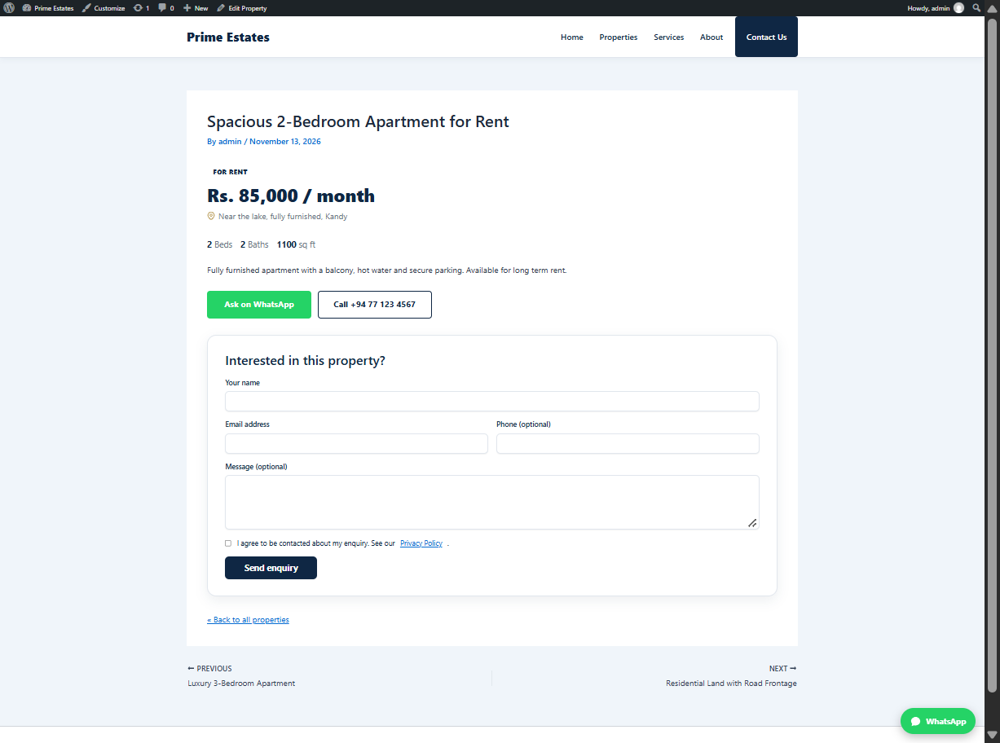
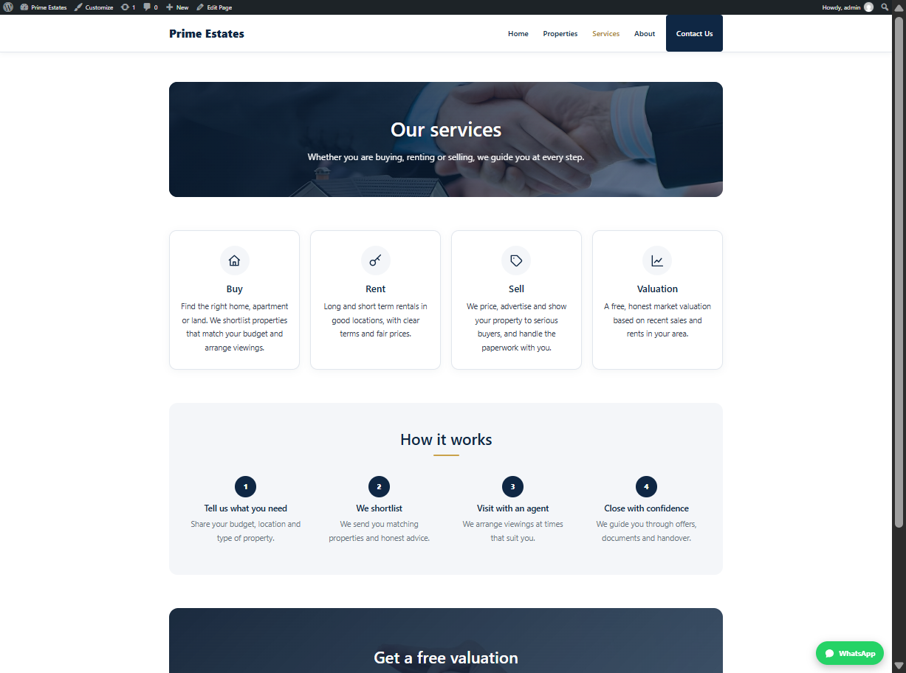
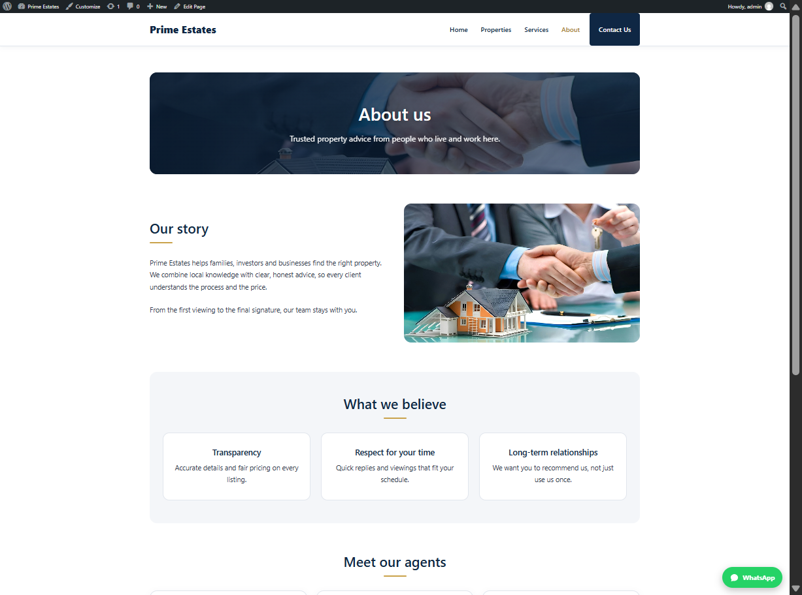
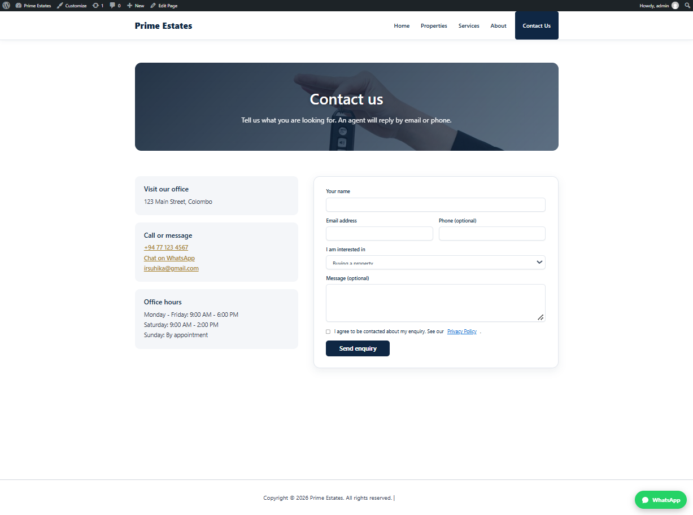

# Prime Estates – Real Estate Website

A professional, responsive real estate website built with **WordPress**, the free **Astra** theme, and a custom PHP plugin. The project supports property listings for sale and rent, property search and filters, individual property pages, and customer enquiries.

The website is designed as a portfolio project and can be run locally using WAMP.

> **Demo content notice:** The business details, property listings, agents, services, reviews, and page text are sample content. Replace them with accurate information before launching a real estate business website.

## Website Screenshots

### Home Page


### Properties Listing Page


### Individual Property Details


### Services Page


### About Us


### Contact Page


## Key Features

### Property Management
- Custom **Properties** post type in the WordPress dashboard.
- Property listing type: For Sale or For Rent.
- Property status: Available, Under Offer, Sold, or Rented.
- Property details including price, bedrooms, bathrooms, floor area, land size, and street address.
- Featured image, Property Type, Location, and Featured listing options.
- Individual property detail pages.

### Property Search & Filtering
- Keyword search.
- Filter by buying or renting.
- Filter by Property Type and Location.
- Minimum and maximum price filters.
- Minimum bedroom filter.
- Paginated property results.
- Shortcodes for displaying all listings or selected/featured listings.

### Customer Enquiries
- Enquiry form associated with the selected property.
- Enquiry interest options for buying, renting, selling, valuation, or other requests.
- Consent checkbox and server-side validation.
- WordPress nonce verification, honeypot spam protection, request rate limiting, and input sanitisation.
- Enquiries inbox in the WordPress admin with status tracking: New, Contacted, Viewing booked, and Closed.
- Email notification to the office and automatic confirmation email to the customer.

### Business Information & Contact
- **Settings → Prime Estates** page to manage business name, description, phone, WhatsApp, email, office address, Google Maps embed, opening hours, social media links, and client reviews.
- Floating WhatsApp contact button and click-to-call link.
- Google Maps section when an embed is configured.
- Client reviews section remains hidden when no reviews are entered.

### Design, SEO & Accessibility
- Responsive layouts for desktop, tablet, and mobile.
- Custom navy and gold styling.
- Inline SVG line icons and consistent property cards.
- SEO meta description and Open Graph metadata.
- `RealEstateAgent` and `RealEstateListing` JSON-LD structured data.
- Built-in SEO output is skipped when Yoast SEO, Rank Math, or AIOSEO is active.
- Visible focus outlines, labelled form fields, ARIA message roles, and reduced-motion support.

## Technologies Used

- **CMS:** WordPress
- **Theme:** Astra (free)
- **Backend:** PHP
- **Frontend:** HTML and CSS
- **WordPress development:** Custom post types, taxonomies, meta boxes, WP_Query, Settings API, shortcodes, and activation hooks
- **Local development:** WAMP Server
- **Version control:** Git and GitHub

## Custom WordPress Plugin

All project-specific functionality is included in:

`plugin/primeestates-setup/`

The **Prime Estates Setup** plugin provides:
- Automatic website page and navigation setup.
- Property post type and Property Type / Location taxonomies.
- Property detail fields and listing status management.
- Property search, filters, listing cards, and pagination.
- Customer enquiry form and enquiries administration inbox.
- Business settings and contact information.
- WhatsApp, Google Maps, and social links.
- SEO metadata and structured data.

### Available Shortcodes

```text
[pe_search]
[pe_listings]
[pe_properties limit="6" featured="1" listing="rent"]
[pe_enquiry]
[pe_services]
[pe_steps]
[pe_agents]
[pe_stats]
[pe_hours]
[pe_contact_info]
[pe_map]
[pe_social]
[pe_testimonials]
[pe_name]
```

## Repository Structure

```text
primeestates-main/
├── docs/
│   └── screenshots/
│       ├── home.png
│       ├── properties.png
│       ├── property-details.png
│       ├── services.png
│       ├── about.png
│       └── contact.png
│
├── plugin/
│   └── primeestates-setup/
│       ├── css/
│       │   └── primeestates.css
│       ├── images/
│       │   ├── hero.jpg
│       │   ├── about.jpg
│       │   ├── cta.jpg
│       │   └── sample-1.jpg ... sample-6.jpg
│       └── primeestates-setup.php
│
├── .gitattributes
├── .gitignore
└── README.md
```

This repository contains the custom plugin, project images, screenshots, and documentation. It does not contain WordPress core or a database export.

## Local Installation (WAMP)

### Requirements
- WAMP Server.
- A separate WordPress installation.
- The free Astra theme.

### Setup Steps
1. Start WAMP Server.
2. Create a MySQL database for the WordPress website.
3. Install WordPress in your local web directory (for example, `C:\\wamp64\\www\\estate`).
4. Log in to the WordPress dashboard.
5. Install and activate the **Astra** theme.
6. Create a ZIP file of the `plugin/primeestates-setup/` folder.
7. In WordPress, go to **Plugins → Add New → Upload Plugin**.
8. Upload the plugin ZIP file and activate **Prime Estates Setup**.
9. Go to **Settings → Permalinks**, select **Post name**, and save the changes.
10. Open **Settings → Prime Estates** and enter the correct business information.
11. Visit the Properties dashboard to review the sample listings and add your own.

## Before Going Live

- Delete the six sample properties and add real listings. For each property, add a featured image, price, details, Property Type, Location, and Featured status if it should appear on the home page.
- Replace sample services, agents, and process steps in the `pe_services`, `pe_steps`, and `pe_agents` lists near the top of `primeestates-setup.php`.
- Edit the About and Privacy Policy page content to match the actual business. The privacy text is a basic template and should be reviewed for commercial use.
- Complete **Settings → Prime Estates**, including the Google Maps embed. You can copy the embed code from Google Maps using **Share → Embed a map**.
- Add genuine client reviews only. The reviews section remains hidden when empty.
- Add optional `hero.jpg`, `about.jpg`, and `cta.jpg` images to the plugin's `images/` folder if you want to customise those sections.
- Configure SMTP (for example, using WP Mail SMTP) to improve enquiry email delivery reliability.
- Use HTTPS, keep WordPress, Astra, and plugins updated, and maintain regular backups.

## Security & Repository Notes

- The `.gitignore` file excludes WordPress configuration files, SQL database dumps, logs, environment files, uploads, and cache files.
- Never commit database credentials, passwords, API keys, private customer information, or production configuration files.
- Configure your own local WordPress database and business contact information.
- Review the privacy policy and enquiry-handling process before collecting real customer data.

## Learning Outcomes

This project demonstrates practical experience in:
- Developing a responsive business website with WordPress.
- Building custom post types, taxonomies, and property meta fields.
- Creating property search and filtering with `WP_Query`.
- Developing custom shortcodes and WordPress admin settings.
- Handling customer enquiries with validation and security checks.
- Managing website assets and source code using Git and GitHub.
